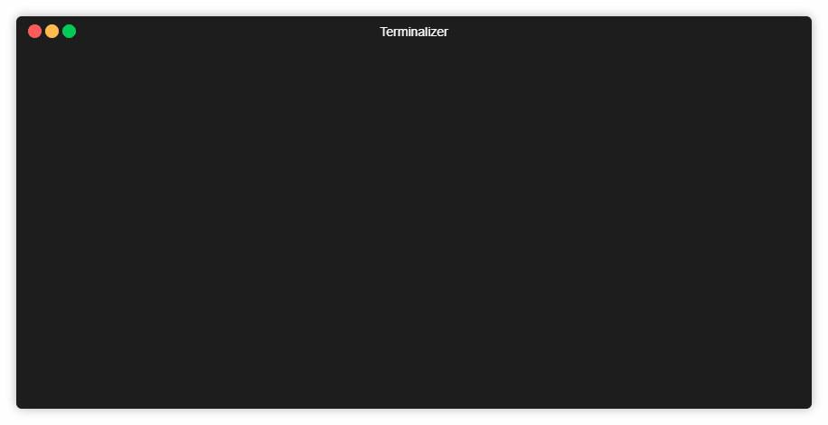

# Base64String - Convert text from/to Base 64 String

[](https://dev.azure.com/Stadub-Gh/PowershellScripts/_build/latest?definitionId=6&branchName=master)
[](https://ci.appveyor.com/project/stadub/powershellscripts-v9ncj/branch/master)
[](https://travis-ci.org/stadub/PowershellScripts)
[](https://www.powershellgallery.com/packages/Base64String/)
[](https://www.powershellgallery.com/packages/Base64String)
<!-- [Documentation](https://powershellscripts.readthedocs.io/en/latest/) -->
[](https://www.powershellgallery.com/packages/Base64String/)
---------------------



## Commands

```powershell
ConvertTo-Base64String [-Value] <string> [[-UrlSafe] <bool>] [-Encoding <string>]
ConvertFrom-Base64String [-EncodedValue] <string> [-Encoding <string>]
```

Both commands default to `Unicode` (UTF-16 little-endian), preserving existing
output. Use `-Encoding UTF8` for UTF-8 services. Other supported values are
`BigEndianUnicode` (UTF-16 big-endian), `UTF32` (little-endian), and `ASCII`.
No byte order mark is added. Base64 does not identify its text encoding: choose
the same encoding in both directions. Text conversion uses .NET's replacement
fallback for characters or byte sequences that the chosen encoding cannot represent.

`UrlSafe` belongs to the encoder: `$true` replaces `+` and `/` with `-` and `_`
and removes padding. The decoder accepts either alphabet and padded or fully
unpadded input automatically. Spaces, tabs, CR and LF are ignored; invalid
characters, impossible lengths, misplaced or incomplete padding raise an error.
Empty input produces an empty string. Each pipeline item is converted separately.
The existing `ConvertTo-Base64String "text" $true` positional form is preserved.

## Aliases

| Cmdlet           | Alias |
| -----------------|:-----:|
| ConvertTo-Base64String   | encode64   |
| ConvertFrom-Base64String | decode64    |

## Usage

Convert text to Base64 String:

```powershell
/> ConvertTo-Base64String -Value "text" -UrlSafe $true
```

```powershell
/> echo "text" | encode64
```

```powershell
/> echo "text" | encode64 -UrlSafe $true
```

Convert text from Base 64 String:

```powershell
/> ConvertFrom-Base64String "dABlAHgAdAA="
```

```powershell
/> echo "dABlAHgAdAA" | decode64
```

UTF-8 interoperability (issue #22):

```powershell
$text = ".d_'+♂¢£"
$encoded = ConvertTo-Base64String $text -Encoding UTF8
$encoded # LmRfJyvimYLCosKj
$encoded | ConvertFrom-Base64String -Encoding UTF8 # returns $text
```

## Instalation

Powershell Gallery:

`PowerShellGet` Installation :

```powershell
Install-Module -Name Base64String
```

Direct download instalation:

```powershell
iex ('$module="Shared-Functions/Base64String"'+(new-object net.webclient).DownloadString('https://raw.githubusercontent.com/stadub/PowershellScripts/master/install.ps1'))
```

Module import:

```powershell
Import-Module Base64String
```

## Changelog

### [v1.3.0] Nov 11, 2026

* Add explicit UTF8, BigEndianUnicode, UTF32 and ASCII encoding options while
  preserving the default UTF-16 little-endian behavior.
* Correct standard and URL-safe Base64 padding validation; reject malformed input.
* Support empty strings and per-item pipeline conversion, preserving existing aliases.
* Include 31 regression cases for encoding interoperability and issue #22.
* Rebuild the reviewed release package reproducibly from matching source files.


### [v1.2.0] Oct 8, 2019

* fix decidong ''1'' ending text

### [v1.1.0] Sept 17, 2019

* Added support url safe Base64 strings

```powershell
ConvertTo-Base64String -Value $text -UrlSafe $true
```

### [v1.0.0] Sept 12, 2019

* Created functions

```powershell
ConvertFrom-Base64String
  [-EncodedValue] <string>

ConvertTo-Base64String
  [-Value] <string>

```

* Created unit tests

### Suggestions and feedback

If you have any idea or suggestion - please add a github issue.
